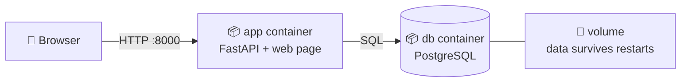

# 🎟️ Meetup RSVP

[](https://github.com/Megghaanaa/meetup-rsvp/actions/workflows/ci.yml)

> **Know who's coming before the doors open.**
> One seat per person, and never more people than chairs. 🪑

I host tech and cultural meetups, and every time it went the same way: a Google Form, three WhatsApp polls, one spreadsheet nobody updated, 80 "yes" replies for a room that fits 30, and Rahul signing up four times "just to be safe."

So I built this. 🎉


---

## ✨ What it does

- 🗓️ **Hosts create events** with a title, venue, time and seat limit
- 🙋 **Attendees reserve a seat** with one click
- 🚫 **No double-booking.** The same email can't RSVP twice (yes, Rahul, even if you type it in CAPS)
- 🪑 **No overbooking.** When the room is full, RSVPs close by themselves
- 👀 **See who's coming**, shown as little seats that fill up as people join

## 🧱 Tech stack

```
┌──────────────────────────────────────────────────────────┐
│  FRONTEND        HTML + CSS + vanilla JS                 │
│      No framework needed for one lovely page             │
└────────────────────────────┬─────────────────────────────┘
                             ▼
┌──────────────────────────────────────────────────────────┐
│  BACKEND         FastAPI · Python 3.13                   │
│      Fast, typed, and gives free interactive API docs    │
└────────────────────────────┬─────────────────────────────┘
                             ▼
┌──────────────────────────────────────────────────────────┐
│  ORM             SQLAlchemy 2.0                          │
│      Same code talks to SQLite or PostgreSQL             │
└────────────────────────────┬─────────────────────────────┘
                             ▼
┌──────────────────────────────────────────────────────────┐
│  DATABASE        PostgreSQL  (SQLite for dev/tests)      │
│      A real database for real RSVPs                      │
└──────────────────────────────────────────────────────────┘

┌──────────────────────────────────────────────────────────┐
│  CONTAINERS      Docker + Docker Compose                 │
│      "Works on my machine" → works on every machine      │
├──────────────────────────────────────────────────────────┤
│  CI              GitHub Actions                          │
│      A robot that runs the tests on every push           │
└──────────────────────────────────────────────────────────┘
```

## 🗺️ How it fits together



```
meetup-rsvp/
├── app/
│   ├── main.py        # API routes (the brain 🧠)
│   ├── models.py      # database tables
│   ├── schemas.py     # input validation (the bouncer 🕶️)
│   ├── database.py    # DB connection: SQLite or PostgreSQL
│   └── static/
│       └── index.html # the ticket-style web page
├── tests/
│   └── test_api.py    # 11 tests that guard the rules
├── Dockerfile
├── docker-compose.yml
└── .github/workflows/ci.yml
```

## 🚀 Run it

### Option 1: Docker (recommended, one command)

```bash
docker compose up --build
```

Then open **http://localhost:8000** 🎉 (and **http://localhost:8000/docs** for the interactive API).

### Option 2: Plain Python

```bash
python3 -m venv .venv
source .venv/bin/activate
pip install -r requirements.txt
uvicorn app.main:app --reload
```

This uses a local SQLite file, so there's nothing else to install.

## 🧪 Tests

```bash
pip install -r requirements-dev.txt
pytest -v
```

11 tests check the important rules: seats are counted correctly, duplicates are blocked (any letter case), full events refuse new RSVPs, and bad input is rejected. GitHub Actions runs them on every push, and the Docker image is only built if they pass. 🟢

## 🔌 API

| Method | Endpoint | What it does |
|---|---|---|
| `GET` | `/health` | "Are you alive?" "Yes." 💓 |
| `POST` | `/events` | Create an event |
| `GET` | `/events` | List events, soonest first |
| `GET` | `/events/{id}` | One event, with seats left |
| `POST` | `/events/{id}/rsvp` | Reserve a seat |
| `GET` | `/events/{id}/attendees` | Who's coming |

Full interactive docs live at `/docs` once the app is running.

## 🤔 Design decisions & trade-offs

**Duplicates are blocked by the database, not just by Python.**
A `UNIQUE (event_id, email)` constraint means that even if two requests arrive at the exact same moment, the database accepts one and rejects the other. Checking only in Python could let both slip through.

**Emails are lowercased before saving.**
So `Meghana@x.com` and `meghana@x.com` are the same person.

**User text is never inserted as raw HTML.**
Names and titles go into the page with `textContent`, so nobody can sneak a `<script>` in as their name. 🛡️

**Known trade-off: the seat check isn't fully race-proof yet.**
If two *different* people grab the very last seat at the same instant, both could get in. The fix is a row lock (`SELECT ... FOR UPDATE`) or an atomic counter in PostgreSQL. It's on the roadmap, and it's a fun one to explain. 😄

☁️ Deployment (AWS + Terraform)

The live app runs on one AWS EC2 server, and every piece of it is created by Terraform:

infra/
├── main.tf            # VPC, subnet, firewall, fixed IP, EC2 server
├── variables.tf       # inputs (region, repo, secrets)
├── outputs.tf         # prints the app URL
└── user_data.sh.tpl   # first-boot script: install Docker, clone, start
Server: EC2 t4g.small (ARM), Ubuntu 24.04, encrypted disk, IMDSv2 required
Firewall: HTTPS open to everyone, SSH only from my IP
HTTPS: Caddy with automatic Let's Encrypt certificates
Containers: app + PostgreSQL + Caddy via Docker Compose, auto-restart on failure
bash
cd infra
cp terraform.tfvars.example terraform.tfvars   # fill in your values
terraform init
terraform apply     # creates everything (~10 min until the site is up)
terraform destroy   # removes everything
🧪 Tests
bash
pip install -r requirements-dev.txt
pytest -v

15 tests check the important rules: you must be signed in to host or RSVP, duplicates are blocked, full events refuse new RSVPs, attendee emails are never exposed, and bad input is rejected. Sign-in is faked in tests with FastAPI dependency overrides, so they run in under a second without calling Google.

GitHub Actions runs them on every push, and the Docker image is only built if they pass. 🟢

🛣️ Roadmap
[x] FastAPI backend with validation
[x] Ticket-style web page
[x] Docker + PostgreSQL
[x] Tests + GitHub Actions CI
[x] 🔐 Sign in with Google (SSO)
[x] ☁️ Deploy to AWS with Terraform (Infrastructure as Code)
[ ] 🔒 Race-proof last-seat booking
[ ] 💾 Automatic database backups
[ ] 🚚 Auto-deploy to AWS when CI passes (CD)
[ ] 📧 Reminder emails the day before

🌐 Live demo: https://16-178-40-31.sslip.io

## 🙏 Notes

Built by [Meghana Peethambaran](https://github.com/Megghaanaa), with AI assistance for parts of the code. Every line was reviewed, run and understood before it went in.

No chairs were harmed in the making of this project. 🪑💛
